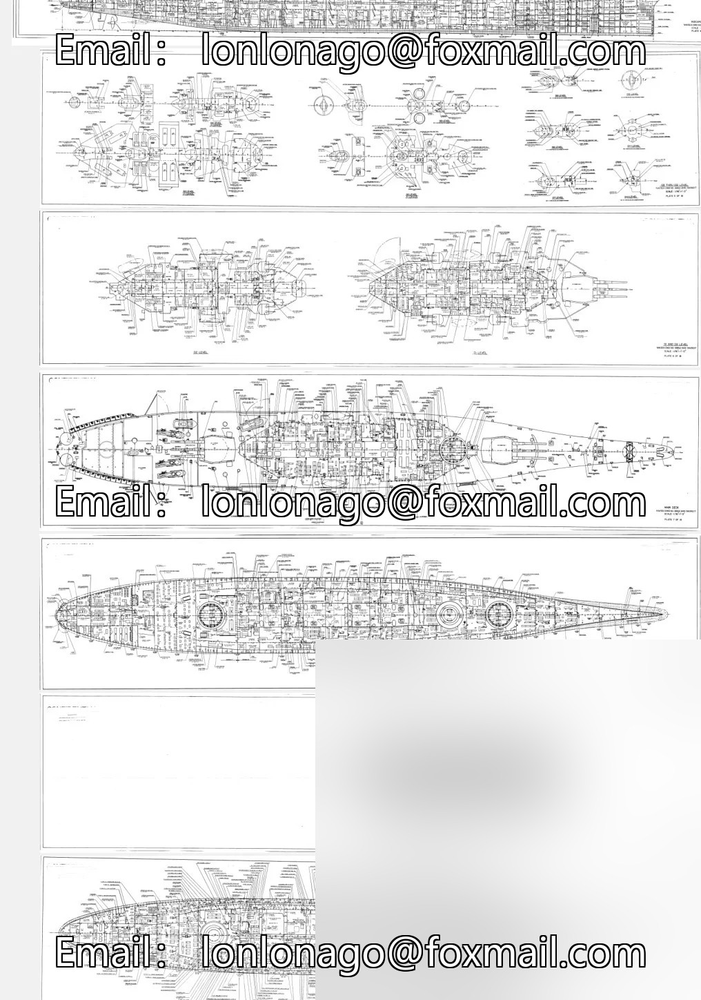
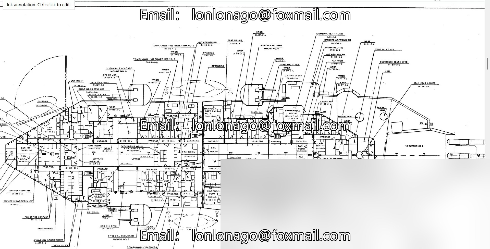
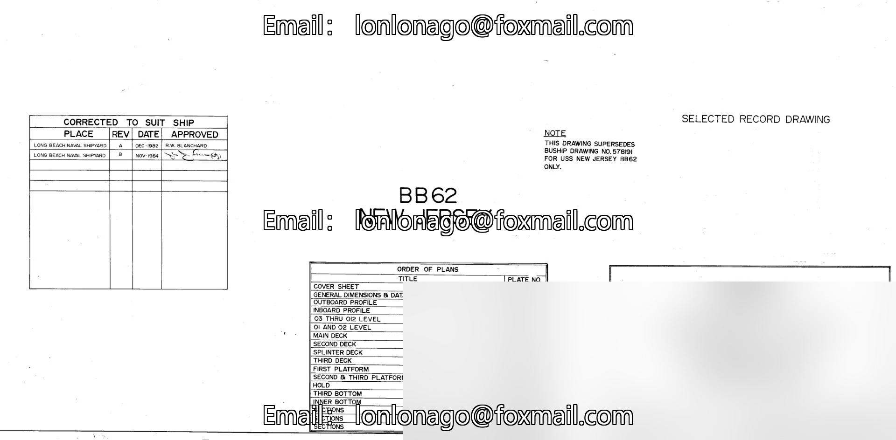
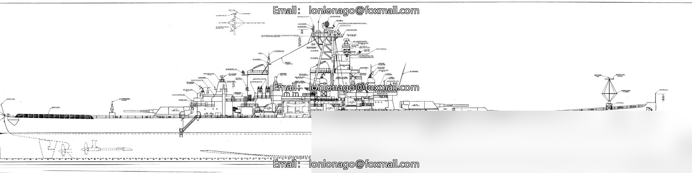
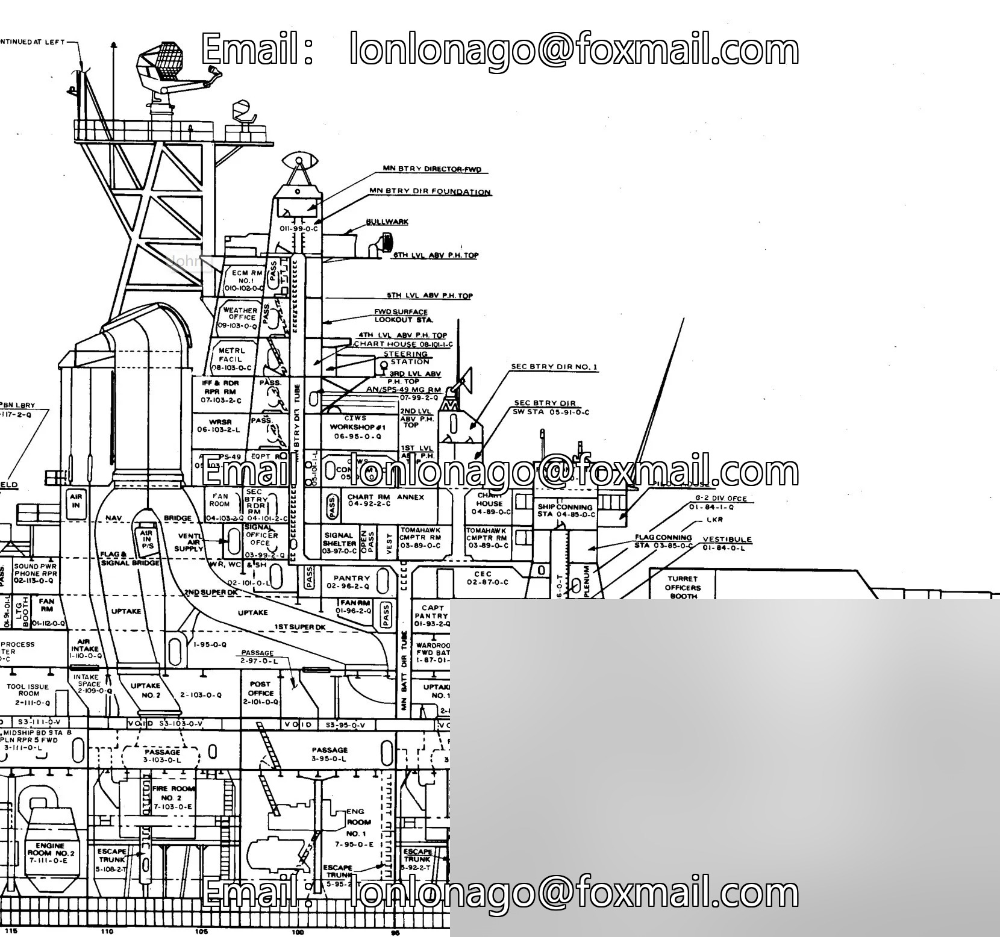

# USS New Jersey, a US Navy BB-62 warship, 1984

## Body

USS New Jersey warship US Navy BB-62 1984 modernization conversion drawing, including the "Tomahawk" missile launch bay modification plan.
1. Core content classification
1. Overall design drawing
Full set of 18 drawings covering in- and out-of-vessel structure, layout of each floor compartment, power system, weapon system and other detailed design.
2. Modification specialized drawing
"Tomahawk" missile launch bay modification plan, with detailed annotations of each component's position, size and technical requirements.
3. Ship body structure drawing
Complete design drawings for the ship exterior plate, internal compartments, power unit, weapon system and other systems.
4. Technical parameter table
Technical parameters such as system performance indicators, material specifications, manufacturing process.
not returned upon sale.

The materials cover the 1984 modernization plans of USS New Jersey, including general design, specialized retrofitting, ship body structure and technical parameters.

<!-- AI_ENRICHED -->

## Images

## Payment

Here is a pay link on Stripe ( https://buy.stripe.com/3cs8yP7sY87d0vu9AB ). Please contact me lonlonago@foxmail.com after funding $89, and I will send you a complete data files , thank you!

